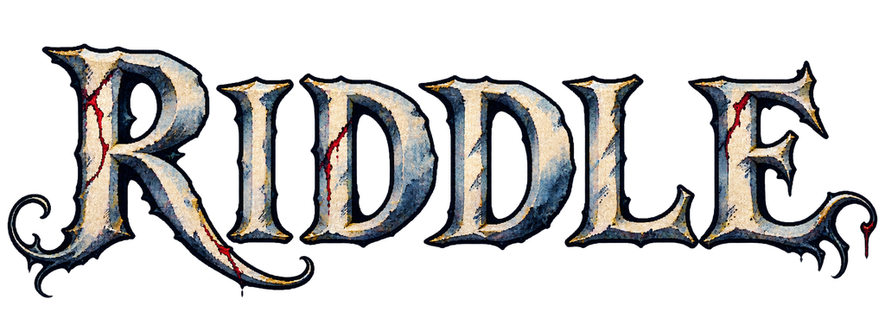
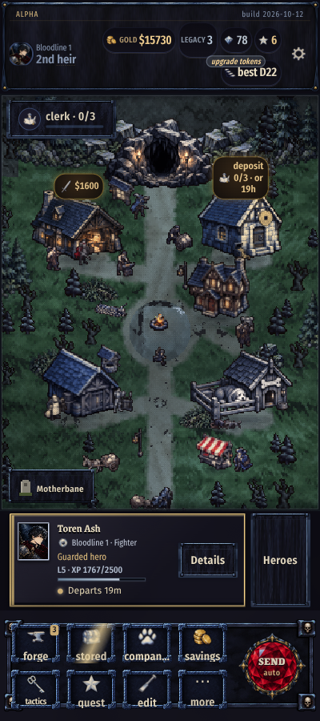
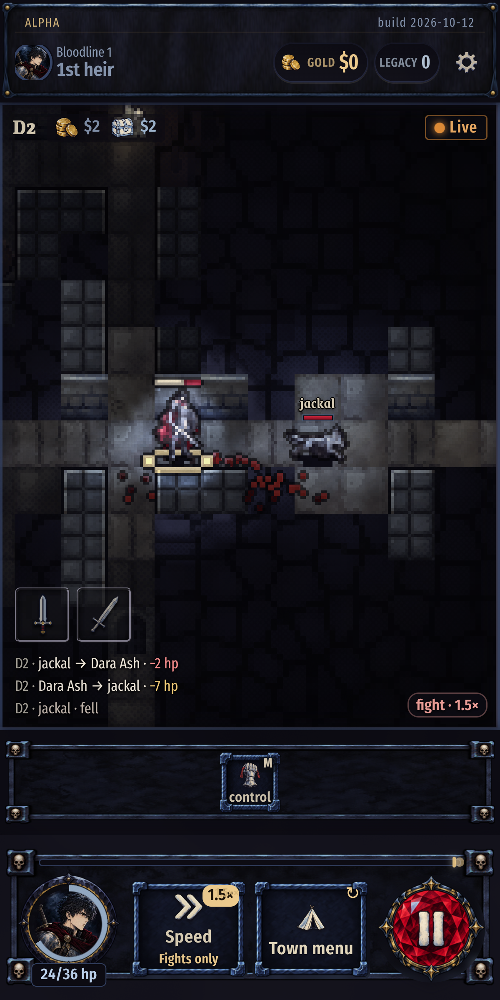
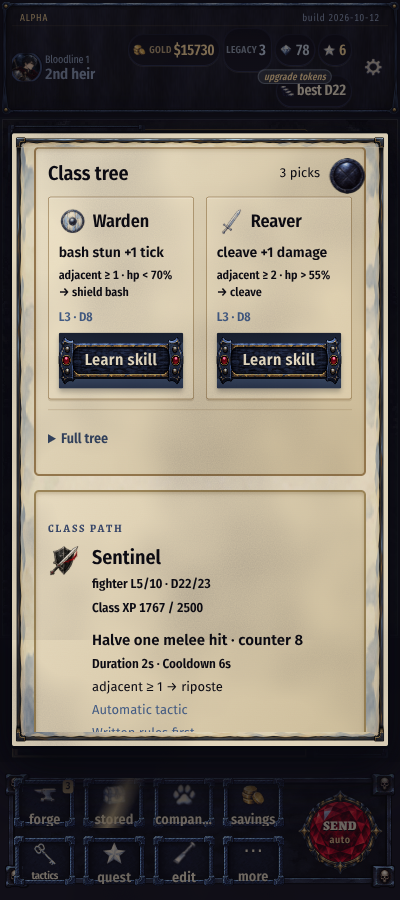

<h1 align="center">
  
</h1>

<strong>Idle roguelike</strong>

  <a href="https://gyng.github.io/riddle/">Play</a> ·
  <a href="https://github.com/gyng/riddle/releases/tag/v0.1.0-alpha.1">Alpha release</a>

Your hero explores the dungeon and fights automatically. Choose equipment,
skills and combat tactics. Build a town and hire workers to prepare future runs.

After you hire the scout, expeditions continue while you are away. Return to
read the results and choose upgrades. Reach the bottom of the dungeon and
defeat the King.

  
  
  

_Town, combat and class skills. Screenshots show development builds._

## Start a game

1. Build the free house. Your first hero arrives.
2. Send the hero into the dungeon. Watch the run or return to town.
3. Choose equipment and tactics when they become available.
4. Hire the scout to send heroes automatically.
5. Learn class skills and add buildings to the town.
6. Unlock the pen later to write your own combat rules.

## Keep progress after a death

A new depth record secures the gold carried up to that checkpoint. If the hero
dies, this gold stays safe. Gold carried after the checkpoint is lost.

Class progress and Legacy upgrades pass to the next hero in the same bloodline.
Legacy upgrades improve that bloodline's future heroes. Town gold is shared
between bloodlines.

Read the death report. Change the equipment or tactics. Send the next hero.

## Game features

- Choose from five classes: Fighter, Rogue, Ranger, Caster and Gunner.
- Class levels provide skill picks. Use picks to learn class skills. Skills
  stay learned until you reset them. Reset class skills for free in town.
- Hire named workers to take over town jobs.
- Develop several bloodlines with different equipment and tactics.
- Review combat logs, death traces and replays of past runs.
- Local time sets the town lighting. Grass moves in the wind. Town characters
  carry lanterns at night.

[Development instructions](AGENTS.md)
